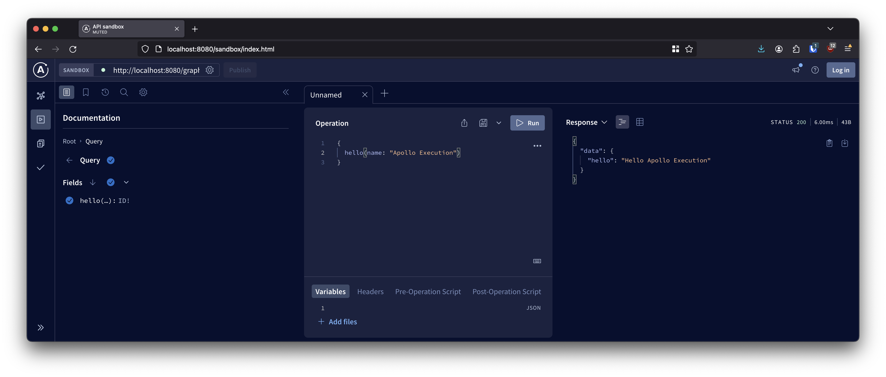

Galak comes with [Spring Webflux](https://docs.spring.io/spring-framework/reference/web/webflux.html) integration.

## Add galak-spring to your project

> Make sure to follow the steps in ["Getting started"](/galak/) first to generate your `ServiceExecutableSchemaBuilder`.

To use the Spring Webflux integration, add `galak-spring` to your dependencies:

```kotlin
dependencies {
  // Add the runtime dependency
  implementation("net.mbonnin.galak:galak-spring:%latest_version%")
}
```

`galak-spring` provides `galakRoutes(ExecutableSchema)` to add GET and POST `/graphql` routes to your application:

```kotlin
@SpringBootApplication
class DefaultApplication {
  @Bean
  fun routes() = coRouter {
    galakRoutes(ServiceExecutableSchemaBuilder().build())
  }
}
```

> `ServiceExecutableSchemaBuilder` is generated by the KSP processor. See ["Getting started"](/galak/) for more details.

You can also opt in the Apollo Sandbox route by using `apolloSandboxRoutes()`

```kotlin
@SpringBootApplication
class DefaultApplication {
  @Bean
  fun routes() = coRouter {
    // /graphql routes
    galakRoutes(ServiceExecutableSchemaBuilder().build())
    // /sandbox/index.html route
    apolloSandboxRoutes()
  }
}
```

`galakSandboxModule()` adds a `sandbox/index.html` route to your application.

Open [`http://localhost:8080/sandbox/index.html`](http://localhost:8080/sandbox/index.html) and try out your API in the [Apollo sandbox](https://www.apollographql.com/docs/graphos/explorer/sandbox/)

[](http://localhost:8080/sandbox/index.html)
